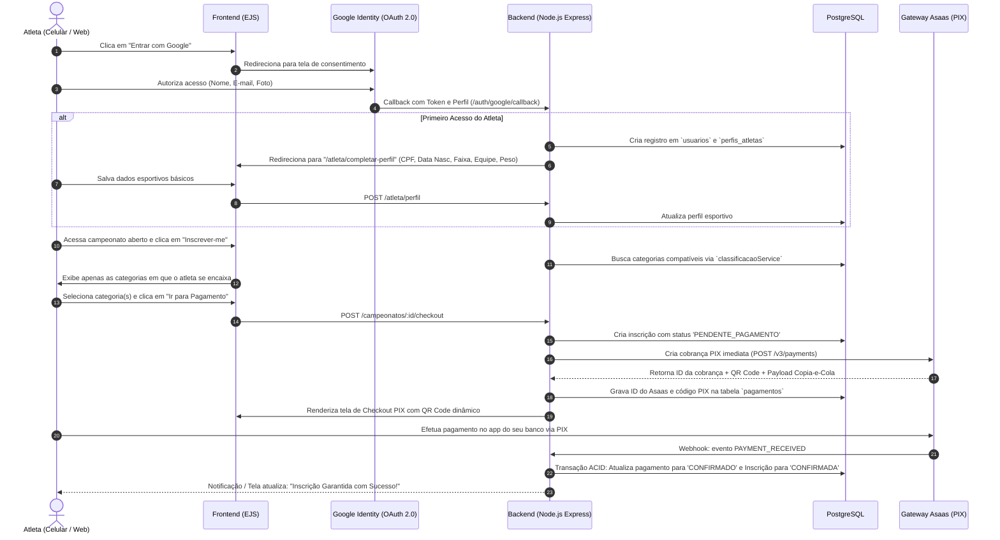

# 🥋 Roadmap Arquitetural: Portal do Atleta, Inscrições Públicas e Autenticação 100% Google OAuth

> **Documento de Engenharia & Planejamento de Produto**  
> **Status:** Aprovado para Implementação  
> **Foco:** Autoatendimento de atletas, checkout via Asaas (PIX) e login sem atrito com Google.

---

## 1. Visão Geral e Proposta de Valor

Atualmente, o sistema opera no modelo fechado (inscrições manuais inseridas por organizadores ou via planilha Excel). O objetivo deste roadmap é abrir as portas para o **autoatendimento direto do atleta**, permitindo que qualquer competidor acesse a plataforma, monte seu perfil esportivo, inscreva-se nas categorias adequadas e pague sua inscrição por PIX com confirmação em tempo real.

### Por Que a Decisão de "100% Google OAuth para Atletas" é Genial?

A exigência de que **atletas façam login exclusivamente via Google** resolve de forma elegante os maiores problemas de sistemas web de grande escala:

1. **Eliminação do Atrito no Celular:** 98% dos atletas usam smartphone. Fazer login com 1 toque no Google evita o abandono de carrinhos de inscrição causado por formulários longos de "Crie sua senha".
2. **Zero Sobrecarga de CPU ([RNF01](requisitos.md#L202)):** O cálculo do `bcrypt` (salt rounds = 12) consome 300ms de CPU a 100% por hash. Atletas autenticados via Google **não possuem senha no nosso banco**, zerando o consumo de CPU de criptografia durante os picos de inscrição!
3. **E-mail Verificado por Padrão:** Não precisamos implementar fluxos de "confirmação de e-mail por token". O e-mail entregue pelo Google já é autêntico e válido.
4. **Proteção Contra Vazamentos e Credential Stuffing:** Como não guardamos senhas de atletas, nosso banco de dados não é alvo de ataques de vazamento de senhas de competidores.

> [!NOTE]
> **Coexistência de Perfis:** Usuários administrativos (Organizadores, Mesários e Administradores) continuam podendo usar login tradicional com senha segura e bcrypt 12 no `/login`, enquanto os atletas utilizam o fluxo OAuth exclusivo.

---

## 2. Jornada do Atleta (Fluxo UX Ponta a Ponta)



---

## 3. Alterações no Banco de Dados (Novas Migrations)

Para suportar esse fluxo de forma limpa, criaremos duas novas migrations sequenciais (`015` e `016`).

### Migration `015_add_google_auth_and_perfis_atletas.sql`

```sql
-- 1. Permitir senha nula para atletas Google e adicionar campos de identidade
ALTER TABLE usuarios 
    ALTER COLUMN senha_hash DROP NOT NULL,
    ADD COLUMN IF NOT EXISTS google_id VARCHAR(100) UNIQUE,
    ADD COLUMN IF NOT EXISTS avatar_url TEXT,
    ADD COLUMN IF NOT EXISTS tipo_usuario VARCHAR(20) NOT NULL DEFAULT 'OPERACIONAL' 
        CHECK (tipo_usuario IN ('OPERACIONAL', 'ATLETA'));

-- 2. Tabela de perfil esportivo do atleta (dados cadastrais permanentes)
CREATE TABLE IF NOT EXISTS perfis_atletas (
    id SERIAL PRIMARY KEY,
    usuario_id INTEGER NOT NULL UNIQUE REFERENCES usuarios(id) ON DELETE CASCADE,
    cpf VARCHAR(14) UNIQUE NOT NULL,
    data_nascimento DATE NOT NULL,
    sexo VARCHAR(10) NOT NULL CHECK (sexo IN ('MASCULINO', 'FEMININO')),
    telefone VARCHAR(20) NOT NULL,
    equipe_id INTEGER REFERENCES equipes(id) ON DELETE SET NULL,
    faixa_id INTEGER REFERENCES faixas(id) ON DELETE RESTRICT,
    peso_atual NUMERIC(5, 2) NOT NULL CHECK (peso_atual > 0),
    created_at TIMESTAMP WITH TIME ZONE DEFAULT CURRENT_TIMESTAMP,
    updated_at TIMESTAMP WITH TIME ZONE DEFAULT CURRENT_TIMESTAMP
);

CREATE INDEX IF NOT EXISTS idx_perfis_atletas_cpf ON perfis_atletas(cpf);
CREATE INDEX IF NOT EXISTS idx_perfis_atletas_usuario_id ON perfis_atletas(usuario_id);
```

### Migration `016_create_pagamentos_e_ajuste_inscricoes.sql`

```sql
-- 1. Ajustar status da tabela inscricoes para cobrir o ciclo de pagamento
ALTER TABLE inscricoes 
    DROP CONSTRAINT IF EXISTS inscricoes_status_check;

ALTER TABLE inscricoes 
    ADD CONSTRAINT inscricoes_status_check 
    CHECK (status IN ('PENDENTE_PAGAMENTO', 'CONFIRMADA', 'CANCELADA', 'PESAGEM_OK', 'DESQUALIFICADA'));

ALTER TABLE inscricoes 
    ADD COLUMN IF NOT EXISTS atleta_usuario_id INTEGER REFERENCES usuarios(id) ON DELETE SET NULL;

-- 2. Tabela de controle financeiro desacoplada
CREATE TABLE IF NOT EXISTS pagamentos (
    id SERIAL PRIMARY KEY,
    inscricao_id INTEGER NOT NULL REFERENCES inscricoes(id) ON DELETE CASCADE,
    atleta_usuario_id INTEGER NOT NULL REFERENCES usuarios(id),
    asaas_cobranca_id VARCHAR(100) UNIQUE NOT NULL,
    forma_pagamento VARCHAR(20) NOT NULL DEFAULT 'PIX' CHECK (forma_pagamento IN ('PIX', 'CARTAO', 'BOLETO')),
    status VARCHAR(30) NOT NULL DEFAULT 'PENDENTE' 
        CHECK (status IN ('PENDENTE', 'CONFIRMADO', 'RECUSADO', 'CANCELADO', 'ESTORNADO')),
    valor NUMERIC(10, 2) NOT NULL CHECK (valor >= 0),
    pix_qrcode_base64 TEXT,
    pix_copia_cola TEXT,
    data_vencimento TIMESTAMP WITH TIME ZONE NOT NULL,
    data_pagamento TIMESTAMP WITH TIME ZONE,
    dados_webhook JSONB,
    created_at TIMESTAMP WITH TIME ZONE DEFAULT CURRENT_TIMESTAMP,
    updated_at TIMESTAMP WITH TIME ZONE DEFAULT CURRENT_TIMESTAMP
);

CREATE INDEX IF NOT EXISTS idx_pagamentos_asaas_id ON pagamentos(asaas_cobranca_id);
CREATE INDEX IF NOT EXISTS idx_pagamentos_inscricao_id ON pagamentos(inscricao_id);
```

---

## 4. O Sistema de Permissões (RBAC) com o Novo Cargo `ATLETA`

No arquivo [`src/config/permissoes.js`](permissoes.js), adicionaremos o novo perfil com isolamento estrito de contexto:

```javascript
const CARGOS = Object.freeze({
  ADMINISTRADOR: 'ADMINISTRADOR',
  ORGANIZADOR: 'ORGANIZADOR',
  OPERADOR: 'OPERADOR',
  ATLETA: 'ATLETA', // 🆕 Novo cargo
});

const PERMISSOES = Object.freeze({
  // Área administrativa (Atleta NÃO tem acesso a nada disso)
  'usuarios.gerenciar': [ADMINISTRADOR],
  'eventos.gerenciar': GESTAO,
  'chaves.gerar': [ADMINISTRADOR, ORGANIZADOR, OPERADOR],
  'lutas.operar': [ADMINISTRADOR, ORGANIZADOR, OPERADOR],

  // Área do Atleta (Autoatendimento)
  'atleta.perfil': [ATLETA],
  'atleta.minhas_inscricoes': [ATLETA],
  'atleta.inscrever': [ATLETA],
});
```

---

## 5. Fases de Execução (Roadmap em 6 Sprints)

### 🗓️ Sprint 1: Fundação Google OAuth 2.0
* **Objetivo:** Permitir login de atletas com o Google e autenticação segura via sessão.
* **Tarefas:**
  1. Criar projeto no **Google Cloud Console**, configurar tela de consentimento e obter `GOOGLE_CLIENT_ID` e `GOOGLE_CLIENT_SECRET`.
  2. Instalar biblioteca de autenticação: `passport` e `passport-google-oauth20`.
  3. Criar rotas:
     * `GET /auth/google` (redireciona para o consentimento).
     * `GET /auth/google/callback` (processa o token e cria/carrega a sessão).
     * `GET /auth/atleta/login` (tela bonita de login com o botão oficial do Google).
  4. Executar Migration `015` de suporte ao Google ID.
* **Critério de Aceite:** O atleta clica no botão, autoriza com sua conta Google e entra autenticado no sistema com `req.session.usuario` ativo.

---

### 🗓️ Sprint 2: Perfil Esportivo do Atleta & Onboarding
* **Objetivo:** Coletar os dados desportivos obrigatórios para chaveamento oficial.
* **Tarefas:**
  1. Middleware `garantirPerfilAtletaCompleto`: se o atleta logar e ainda não tiver CPF/Faixa/Data de Nascimento cadastrados, redireciona obrigatoriamente para `/atleta/completar-perfil`.
  2. Criar view EJS moderna e mobile-first `views/atleta/perfil.ejs`.
  3. Validação rigorosa no `validators/atletaValidator.js` (validação matemática de CPF, formato de telefone, data de nascimento compatível).
  4. Atrelar academia/equipe (com busca rápida de academias cadastradas).
* **Critério de Aceite:** Atleta completa o perfil em menos de 1 minuto pelo celular.

---

### 🗓️ Sprint 3: Catálogo Público de Campeonatos & Filtro de Categorias Inteligente
* **Objetivo:** O atleta escolhe o campeonato e o sistema indica exatamente em quais categorias ele pode lutar.
* **Tarefas:**
  1. Criar rota pública `GET /campeonatos-abertos` (vitrine de eventos com inscrições abertas).
  2. Reaproveitar o motor existente `classificacaoService.buscarCategoriasDisponiveis(inscricao, categoriasDoEvento)`.
  3. A tela de inscrição calcula a idade oficial da CBJJ (ano do campeonato menos ano de nascimento) e exibe apenas as categorias permitidas para a faixa, peso e sexo do atleta.
  4. Validação anti-duplicação: impedir que o atleta se inscreva duas vezes na mesma categoria do mesmo evento.
* **Critério de Aceite:** O atleta nunca cai em uma categoria errada por engano; a inteligência do sistema filtra as opções certas.

---

### 🗓️ Sprint 4: Integração com Gateway Asaas (Checkout PIX)
* **Objetivo:** Gerar cobrança PIX automática no momento do clique em "Finalizar Inscrição".
* **Tarefas:**
  1. Criar service `src/services/asaasService.js` com comunicação via `fetch` nativo do Node 18+ com a API Asaas (`https://api.asaas.com/v3`).
  2. No checkout (`POST /atleta/inscricoes`):
     * Cria a inscrição com status `PENDENTE_PAGAMENTO`.
     * Dispara chamada para a API Asaas gerando a cobrança com vencimento em 24h.
     * Obtém o QR Code em Base64 e a chave copia-e-cola.
     * Grava os dados na tabela `pagamentos`.
  3. Criar view EJS `views/atleta/pagamento.ejs` exibindo:
     * QR Code do PIX em tamanho grande para escanear.
     * Botão com clique único para "Copiar Código PIX".
     * Contador regressivo de validade do PIX.
* **Critério de Aceite:** O atleta gera o QR Code PIX em menos de 2 segundos.

---

### 🗓️ Sprint 5: Webhooks do Asaas & Confirmação Automática Atômica
* **Objetivo:** O atleta paga no banco dele e a inscrição é confirmada instantaneamente, sem intervenção humana.
* **Tarefas:**
  1. Criar endpoint público `POST /api/webhooks/asaas`.
  2. **Segurança do Webhook:** Validar o cabeçalho `asaas-access-token` contra o segredo definido no `.env`.
  3. **Idempotência:** Tratar o evento `PAYMENT_RECEIVED` dentro de uma transação PostgreSQL (`BEGIN ... COMMIT`):
     ```sql
     UPDATE pagamentos SET status = 'CONFIRMADO', data_pagamento = NOW() WHERE asaas_cobranca_id = $1;
     UPDATE inscricoes SET status = 'CONFIRMADA' WHERE id = (SELECT inscricao_id FROM pagamentos WHERE asaas_cobranca_id = $1);
     ```
  4. Tratar estornos (`PAYMENT_REFUNDED`) e vencimentos (`PAYMENT_OVERDUE`).
* **Critério de Aceite:** Assim que o PIX é aprovado, a inscrição vira `CONFIRMADA` e o atleta já entra automaticamente nas listas de sorteio de chave do campeonato.

---

### 🗓️ Sprint 6: Painel "Minhas Inscrições" & Experiência no Dia do Evento
* **Objetivo:** Área do atleta para acompanhar suas lutas e comprovar pagamento.
* **Tarefas:**
  1. Criar tela `GET /atleta/minhas-inscricoes`:
     * Card para cada campeonato com status (Pendente, Confirmado, Pesagem OK).
     * Comprovante digital de inscrição com código de barras/QR Code para a mesa de pesagem.
     * Link direto para a sua chave de lutas assim que ela for sorteada pelos mesários.
  2. Implementação de polling suave ou Server-Sent Events (SSE) na tela de pagamento para detectar automaticamente quando o PIX foi pago e redirecionar para a confirmação sem precisar atualizar a página.
* **Critério de Aceite:** O atleta acompanha todo o seu histórico e no dia do torneio apenas mostra a tela no celular para o mesário na pesagem.

---

## 6. Variáveis de Ambiente Necessárias (`.env`)

Ao iniciar o desenvolvimento, adicione estas variáveis no arquivo `.env`:

```env
# Google OAuth 2.0 (Obtido no Google Cloud Console)
GOOGLE_CLIENT_ID=seu_client_id_aqui.apps.googleusercontent.com
GOOGLE_CLIENT_SECRET=seu_client_secret_aqui
GOOGLE_CALLBACK_URL=https://opendracena.com/auth/google/callback

# Gateway de Pagamento Asaas
ASAAS_API_URL=https://api.asaas.com/v3 # ou https://sandbox.asaas.com/v3 para testes
ASAAS_API_KEY=$aact_sua_chave_de_api_aqui
ASAAS_WEBHOOK_TOKEN=seu_token_secreto_de_webhook_aqui
```

---

## 7. Benefícios Técnicos e Operacionais Deste Modelo

* **Carga no Servidor Quase Zero:** A máquina Lightsail de $7 com 2 vCPUs suporta milhares de acessos desse fluxo porque a autenticação pesada é terceirizada nos servidores mundiais do Google e as consultas de compatibilidade são resolvidas em menos de 5ms no PostgreSQL indexado.
* **Zero Disputas Financeiras:** Todo pagamento é reconciliado via ID único do Asaas com log de auditoria automático.
* **Zero Trabalho Manual de Cadastro:** O mesário no dia do evento não perde tempo digitando nomes de atletas: as chaves já nascem prontas e completas, bastando clicar no botão de sorteio oficial!
